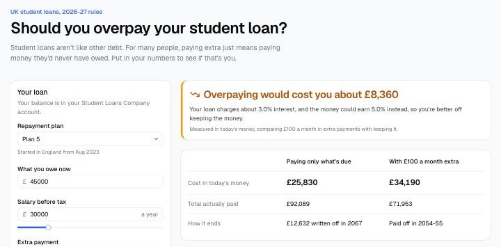

# Should you overpay your student loan?

[](https://github.com/patrickridge/student-loan-calculator/actions/workflows/ci.yml)

Live site: https://student-loan-repayment.vercel.app

A calculator for UK student loans. Put in your plan, balance and salary, and it tells you whether paying extra each month would save you money, or whether you'd just be paying off debt that gets written off anyway.



## Why

Most people treat a student loan like any other debt and want it gone. But it works more like a 9% tax on earnings above a threshold, which stops when the loan is cleared or written off after 25 to 40 years. Whether overpaying makes sense depends on whether you'd ever clear it, and on whether the loan's interest is higher than what the money could earn elsewhere. That's a calculation, not a feeling, so I built it.

## How it works

**Rules.** Thresholds, repayment rates, interest and write-off terms for Plans 1, 2, 4, 5 and the Postgraduate Loan, for the 2026-27 tax year, from GOV.UK. Each figure is in `lib/rules.ts` with its source. Plan 2 and Plan 5 thresholds follow the freezes in the Department for Education's forecasts, then rise with inflation.

**Projection.** `lib/loan.ts` steps through the loan a tax year at a time: add a year's interest to what you owe, take 9% of salary above the threshold (6% for Postgraduate Loans) plus any extra payment, and stop when it's paid off or the write-off date arrives.

**The comparison.** Paying extra means paying more now and less later. To compare the two fairly, every payment is converted to today's money by discounting it at the return you could earn instead (5% a year by default):

```
cost = Σ payment in year t / (1 + r)^t
```

Overpaying is worth it if it lowers that cost. The app also says why: if the loan's interest rate is below `r`, paying early loses whatever happens; if it's above and overpaying still loses, the write-off is the reason.

## Limitations

- Interest is added once a year, not monthly, and payments come at the end of the year.
- Inflation, pay rises and investment returns are single numbers you choose. Real ones move.
- Plans 1 and 4 actually charge the lower of RPI and the Bank of England rate plus 1%; this uses RPI.
- The 6% interest cap is assumed to stay. Write-off at age 65 for very old Plan 1 and Plan 4 loans isn't modelled.
- It's a guide, not financial advice.

## Running it locally

Needs Node 24.

```bash
npm install
npm run dev
```

Then open http://localhost:3000.

## Checks

```bash
npm test            # unit tests for the rules and the projection
npm run lint
npm run typecheck
npm run build
```

GitHub Actions runs all four on every push. The projection was also checked against an independent spreadsheet model and matched to the penny.

## Code layout

```
lib/rules.ts            Plan rules for 2026-27, with sources
lib/loan.ts             Year-by-year projection and the overpay comparison (no UI)
lib/loan.test.ts        Tests with hand-checkable numbers
components/Calculator.tsx   The calculator
components/fields.tsx   Number inputs and sliders
components/ui/          shadcn/ui components
app/page.tsx            Page layout and explainer
```

Built with Next.js, TypeScript, Tailwind CSS, shadcn/ui and Recharts. Everything runs in the browser, so the site is static and nothing you type is sent anywhere.

## What I'd do next

1. Monthly interest and payments, to match the Student Loans Company's own figures more closely.
2. Ranges instead of single guesses: run many paths for pay and inflation and show how often overpaying wins.
3. Let people paste their annual statement and fill in the numbers.

## Licence

MIT. See [LICENSE](LICENSE).
